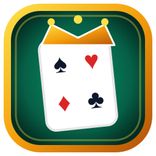

<div align="center">

  

  # 👑 Contrée Royale Online

  **L'expérience ultime de Belote Contrée en ligne et hors-ligne.**  
  *Multijoueur Peer-to-Peer direct sans serveur dédié & Solo contre des IA compétitives.*

  [](https://react.dev/)
  [](https://vitejs.dev/)
  [](https://tailwindcss.com/)
  [](https://webrtc.org/)
  [](https://www.electronjs.org/)

</div>

---

## 📖 Présentation

**Contrée Royale** est une application moderne et soignée de **Belote Contrée**, jouable :
- 🌐 **En multijoueur Peer-to-Peer** (connexion directe PC à PC à distance, sans aucun serveur dédié payant).
- 🤖 **En solo** avec des partenaires et adversaires gérés par une intelligence artificielle dotée de 3 niveaux de difficulté.

Inspirée de l'ergonomie et de la fluidité des plus grandes plateformes en ligne (comme *Belote.com*), elle fonctionne directement dans le navigateur et se compile en un exécutable Windows autonome portable (`.exe`).

---

## 📑 Sommaire

- [✨ Fonctionnalités Principales](#-fonctionnalités-principales)
  - [🃏 Règles Authentiques de la Contrée](#-règles-authentiques-de-la-belote-contrée)
  - [🌐 Multijoueur P2P Sans Serveur](#-multijoueur-peer-to-peer-sans-serveur)
  - [🤖 3 Niveaux d'Intelligence Artificielle](#-3-niveaux-dintelligence-artificielle)
  - [🔊 Audio & Affichage](#-audio--affichage-personnalisables)
- [🚀 Installation & Lancement](#-installation--lancement-développement)
- [📦 Générer l'Exécutable Windows (.exe)](#-générer-lexécutable-windows-exe)
- [🛠️ Stack Technique](#️-stack-technique)
- [📜 Rappel du Barème des Cartes](#-rappel-du-barème-des-cartes)

---

## ✨ Fonctionnalités Principales

### 🃏 Règles Authentiques de la Belote Contrée

- **Distribution réaliste (CSPRNG)** : Brassage cryptographique sans biais (`window.crypto.getRandomValues`), coupe virtuelle du paquet et distribution par paquets traditionnels de **3 + 2 + 3** cartes.
- **Phase d'enchères complète** :
  - Annonces de **80 à 160** points et **Capot** (250 pts).
  - Gestion du **Contre (x2)** et du **Surcontre (x4)**.
  - Tableau récapitulatif des 4 joueurs en temps réel.
- **Règles officielles de pose de carte** :
  - Obligation absolue de **fournir à la couleur demandée**.
  - Obligation de **monter à l'atout** (surcouper) lorsqu'on joue atout.
  - Obligation de **couper** si l'adversaire est maître du pli.
  - Liberté de défausser (*« pisser »*) lorsque le partenaire est déjà maître du pli.
- **Belote & Rebelote (+20 pts)** : Détection et annonce automatiques lors de la pose successive du Roi et de la Dame d'atout.
- **Confort de jeu & Ergonomie** :
  - Tri automatique des atouts à gauche dès la fin des enchères.
  - Rangement des cartes par puissance décroissante (de gauche à droite).
  - Calcul dynamique du score de la manche en direct.
  - Aperçu permanent du dernier pli ramassé accessible d'un clic.

---

### 🌐 Multijoueur Peer-to-Peer (Sans Serveur)

- **Salon Rapide par Code (5 lettres)** : Connexion instantanée et directe entre deux machines via WebRTC / PeerJS.
- **Pont Direct Manuel WebRTC (Code 1 / Code 2)** : Permet de relier deux joueurs à travers n'importe quel pare-feu strict ou navigateur en s'échangeant une clé de session chiffrée (via Discord, WhatsApp, etc.).
- **Choix libre des sièges** :
  - Jouez en coopération (**Nord-Sud**) avec un ami contre 2 IA.
  - Affrontez votre ami en duel (**Sud vs Est**).
  - Les sièges vacants sont immédiatement pris en charge par les bots.

---

### 🤖 3 Niveaux d'Intelligence Artificielle

| Niveau | Caractéristiques & Comportement |
| :--- | :--- |
| 🟢 **Débutant** | Enchères prudentes (80 à 100 max) et jeu de carte accessible, idéal pour découvrir les mécanismes de la Belote Contrée. |
| 🟡 **Confirmé** | Niveau équilibré : montées jusqu'à 130, soutien éclairé des annonces du partenaire et ouvertures classiques aux As. |
| 🔴 **Professionnel** | Moteur expert avec mémoire exhaustive des 32 cartes jouées (`playedCardsHistory`), matrice des coupes/défausses adverses (`voidMatrix`), traque active des atouts adverses, sacrifice et démarque des 10/As sur le pli maître du partenaire et gestion des appels. |

---

### 🔊 Audio & Affichage Personnalisables

- **Moteur Audio Synthétique (Web Audio API)** :
  - Aucun fichier MP3/WAV lourd à charger.
  - Sons synthétisés nativement en temps réel : claquement de carte sur feutrine, glissement de ramassage des plis, annonces, alertes de contre et fanfare de victoire.
- **Mixeur de Sons Dédié** :
  - Curseur de volume général.
  - Réglage indépendant des bruitages de cartes, des annonces et de l'interface.
- **Affichage Épuré** :
  - Bascule instantanée entre le mode Fenêtré et Plein Écran sans barres noires.

---

## 🚀 Installation & Lancement (Développement)

### Prérequis
- [Node.js](https://nodejs.org/) (version 18 ou supérieure recommandée)
- [Git](https://git-scm.com/)

### 1. Cloner le dépôt et installer les dépendances

```bash
git clone https://github.com/LoupdKoko/contree-royale.git
cd contree-royale
npm install
```

### 2. Démarrer le serveur de développement

```bash
npm run dev
```

L'application sera accessible immédiatement sur :  
👉 **http://localhost:5173/**

---

## 📦 Générer l'Exécutable Windows (.exe)

Pour compiler une version autonome exécutable sans nécessiter de navigateur :

### 1. Générer l'icône officielle de l'application
Le script génère les fichiers `public/logo.svg` et l'icône multi-résolution `public/icon.ico` :

```bash
node generate-icon.cjs
```

### 2. Compiler l'exécutable portable

```bash
npm run dist:exe
# ou
npm run dist.exe
```

Les fichiers générés se trouveront dans le dossier `dist/` :
- 📁 **`dist/ContreeRoyale 1.0.0.exe`** : Version portable prête à l'emploi (aucun installateur requis, idéal pour partager sur clé USB ou Discord).
- 📁 **`dist/win-unpacked/ContreeRoyale.exe`** : Dossier de l'exécutable décompressé pour lancement direct.

---

## 🛠️ Stack Technique

- **Frontend** : [React 19](https://react.dev/), [Vite](https://vitejs.dev/), [Tailwind CSS](https://tailwindcss.com/), [Lucide React](https://lucide.dev/) (icônes vectorielles).
- **Moteur Audio** : [Web Audio API](https://developer.mozilla.org/fr/docs/Web/API/Web_Audio_API) (synthèse granulaire et modulaire en temps réel).
- **Réseau P2P** : WebRTC (`RTCPeerConnection`, `RTCDataChannel`), [PeerJS](https://peerjs.com/), Firebase Firestore (médiateur de session de secours).
- **Packaging Desktop** : [Electron](https://www.electronjs.org/) & [Electron-Builder](https://www.electron.build/).

---

## 📜 Rappel du Barème des Cartes

Dans la Belote Contrée, les valeurs et les ordres diffèrent selon que la couleur jouée est **Atout** ou **Hors Atout** :

| Rang | À l'Atout (Ordre & Valeur) | Hors Atout (Ordre & Valeur) |
| :---: | :--- | :--- |
| **1ᵉʳ** | 🃏 **Valet** — 20 pts | 🅰️ **As** — 11 pts |
| **2ᵉ** | 9️⃣ **Neuf** — 14 pts | 🔟 **Dix** — 10 pts |
| **3ᵉ** | 🅰️ **As** — 11 pts | 🤴 **Roi** — 4 pts |
| **4ᵉ** | 🔟 **Dix** — 10 pts | 👸 **Dame** — 3 pts |
| **5ᵉ** | 🤴 **Roi** — 4 pts | 🃏 **Valet** — 2 pts |
| **6ᵉ** | 👸 **Dame** — 3 pts | 9️⃣ **Neuf** — 0 pt |
| **7ᵉ** | 8️⃣ **Huit** — 0 pt | 8️⃣ **Huit** — 0 pt |
| **8ᵉ** | 7️⃣ **Sept** — 0 pt | 7️⃣ **Sept** — 0 pt |

> 💡 **Rappel des totaux** :  
> - **Total des plis** : 152 points + 10 points de **Der** (dernier pli remporté) = **162 points**.  
> - **Belote & Rebelote** : + 20 points supplémentaires si le camp détient et pose le Roi et la Dame d'atout.  
> - **Total maximal d'une manche** : **182 points** (ou 250 points en cas de Capot annoncé et réussi).